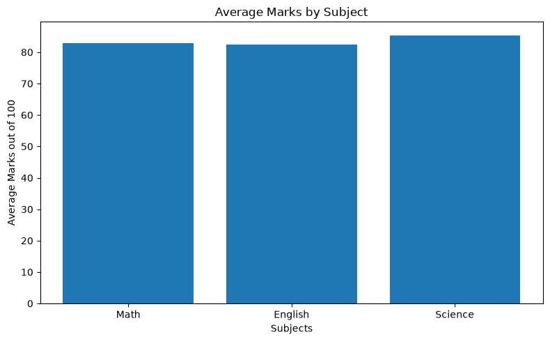

# 🎓 Students Marks Analysis

### A Python Data Science Project | Data Analysis | Data Visualization

An exploratory Data Science project that analyzes student academic performance using Python. This project explores marks across different subjects, calculates performance metrics, identifies top performers, and presents insights through visualizations.


---

## 📌 Project Overview

This project analyzes a sample dataset of 10 students across three subjects:

- Mathematics
- English
- Science

The goal is to understand student performance, calculate useful statistics, and communicate findings through data visualization.

## 🎯 Project Objectives

- Explore and understand student marks data.
- Calculate total marks and percentages.
- Identify the class average.
- Find the highest-performing student.
- Classify students as Pass or Fail.
- Compare average marks across subjects.
- Visualize academic performance.

## 🛠️ Tools & Technologies

- Python
- Pandas
- NumPy
- Matplotlib
- Jupyter Notebook

## 📊 Key Findings

- **Total Students:** 10
- **Subjects:** 3
- **Top Student:** Maryam
- **Highest Total:** 291 / 300
- **Highest Subject Average:** Science

## 📈 Project Visualization



## 📂 Repository Structure

```text
students-marks-analysis/
│
├── students_marks_analysis.ipynb
├── students_marks_results.csv
├── students_marks_Analysis.png
├── requirements.txt
└── Readme.md
```

## 🚀 How to Run

1. Clone or download this repository.
2. Install the required libraries:

```bash
pip install -r requirements.txt
```

3. Open `students_marks_analysis.ipynb` in Jupyter Notebook or VS Code.
4. Run the notebook cells in order.

## 📁 Project Files

- **Notebook:** Python code, analysis, and visualizations.
- **CSV:** Analyzed student results.
- **PNG:** Student marks visualization.
- **Requirements:** Required Python libraries.

## ⚠️ Important Note

This project uses sample data created for learning and practice. It does not contain real student records or official examination results. The 50% Pass/Fail threshold is used only for practice.

## 👩‍💻 Author

**Afifa Fatima**

Aspiring Data Scientist | Python | Data Analysis | Data Visualization

---

⭐ If you find this project interesting, feel free to explore the notebook!

